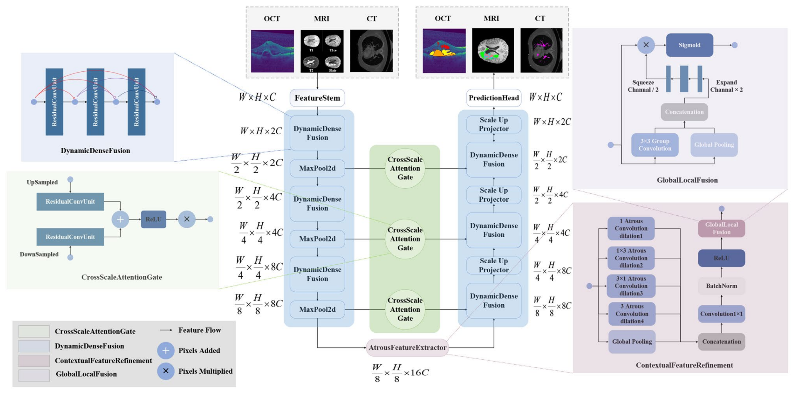
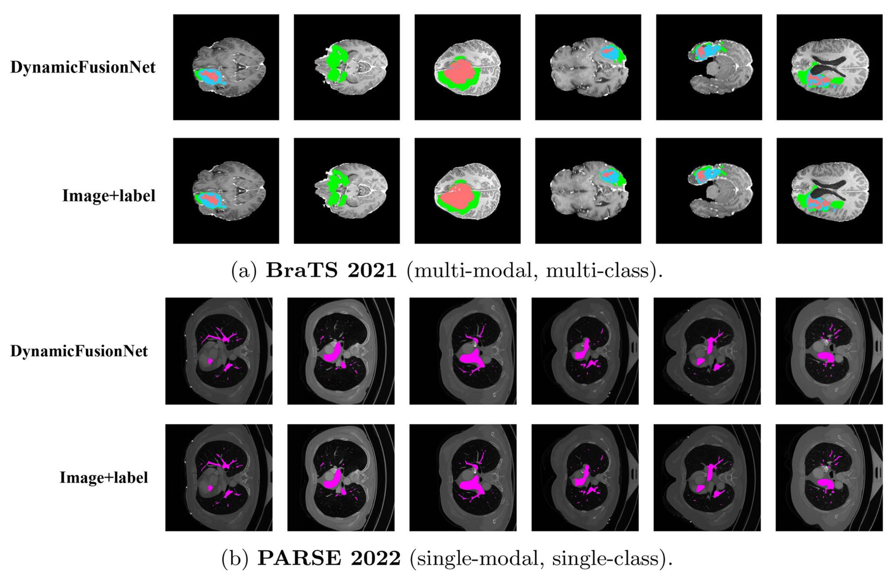
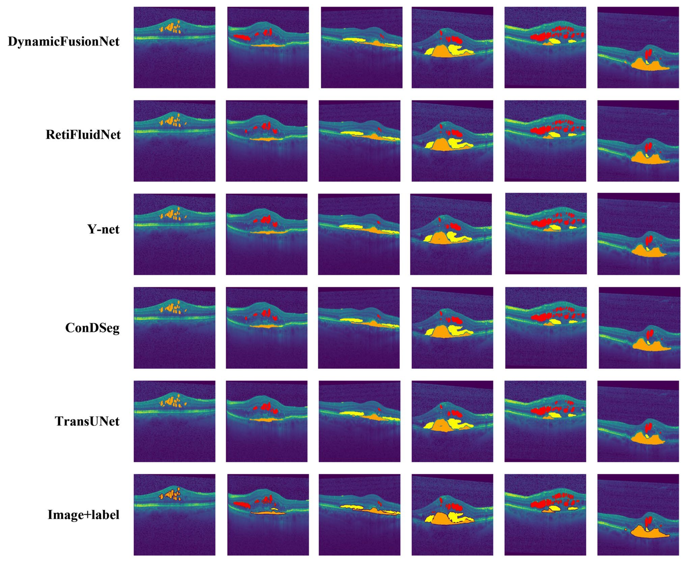
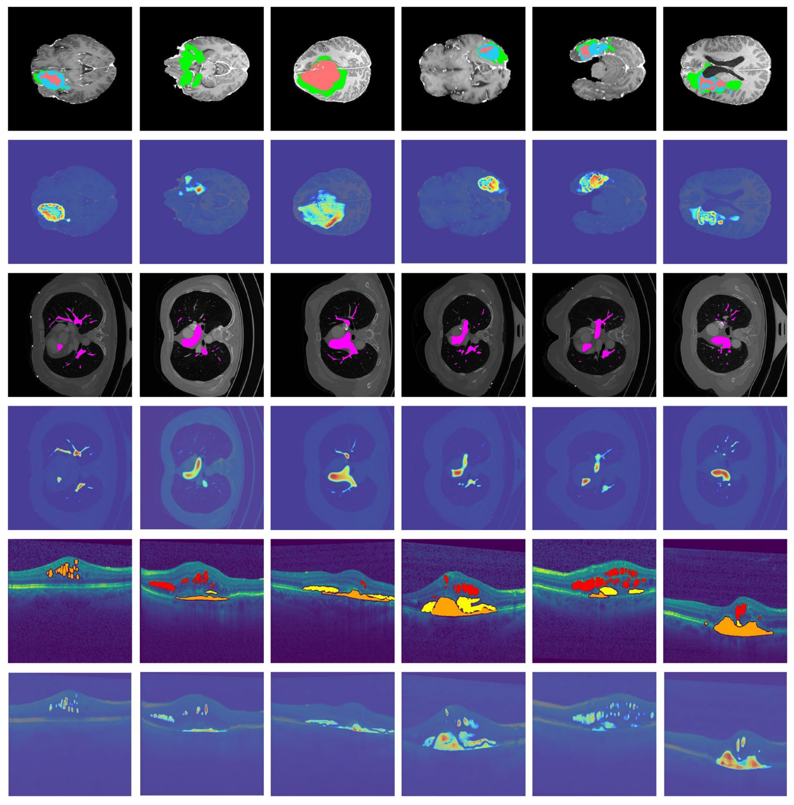
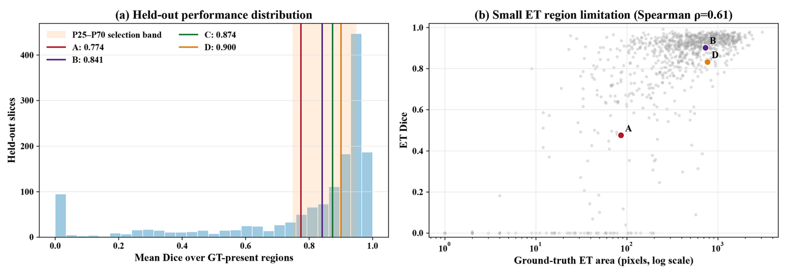
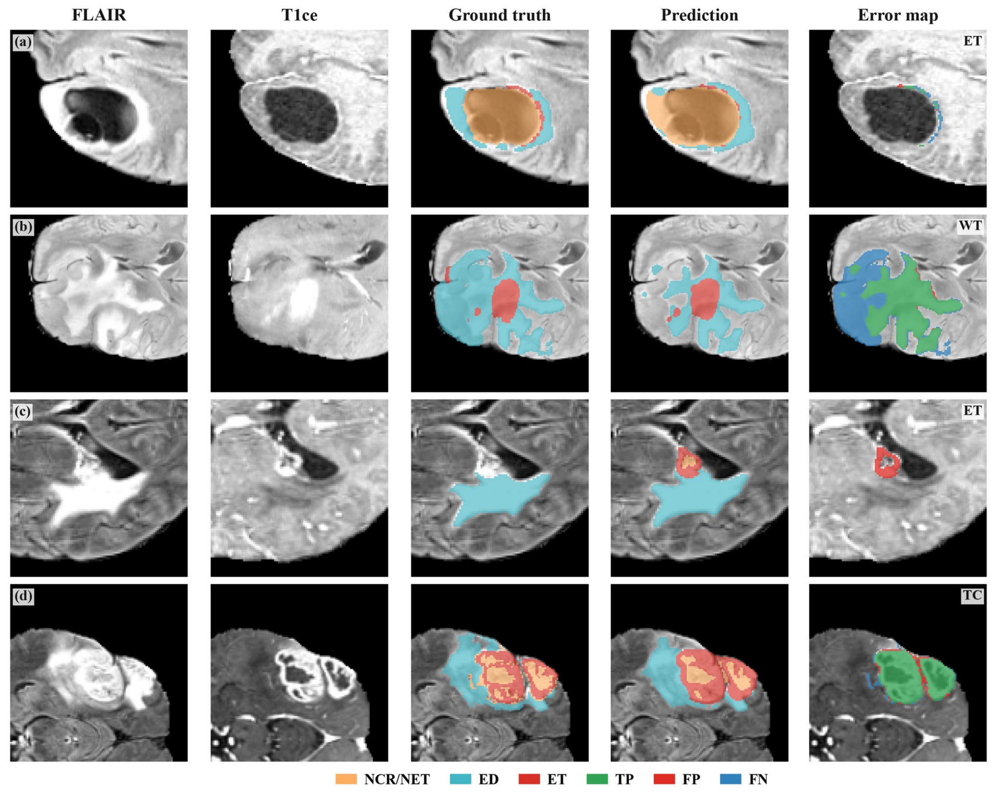

<div align="center">

# DynamicFusionNet

**Dynamic layer, view, and scale fusion for medical image segmentation**

[Paper](https://doi.org/10.1186/s40644-026-01150-5) · [Installation](#installation) · [Quick start](#quick-start) · [Citation](#citation)

</div>

This repository contains the PyTorch implementation of **“Dynamic layer_view_scale fusion for multimodal medical segmentation”**, published in *Cancer Imaging* (2026).

DynamicFusionNet learns to combine features across layers, scales, and global–local views for medical image segmentation. Its 2D encoder–decoder brings together dense feature fusion, multi-scale contextual refinement, global–local feature modulation, and gated skip connections. The paper evaluates the model on MRI, OCT, and CT images.

The model is available in [`DynamicFusionNet.py`](DynamicFusionNet.py) for integration into your segmentation experiments.

## Architecture

<p align="center">
  <a href="assets/architecture.png">
    
  </a>
  <br>
  <sub>Figure 2 from the paper. Click the image to view the high-resolution version.</sub>
</p>

## Qualitative results

<table>
  <tr>
    <th align="center">BraTS 2021 &amp; PARSE 2022</th>
    <th align="center">RETOUCH (OCT)</th>
    <th align="center">Grad-CAM</th>
  </tr>
  <tr>
    <td align="center" valign="top"><a href="assets/brats-parse.png"></a></td>
    <td align="center" valign="top"><a href="assets/retouch.png"></a></td>
    <td align="center" valign="top"><a href="assets/gradcam.png"></a></td>
  </tr>
  <tr>
    <td align="center"><sub>Paper Fig. 3 · Predictions and labels</sub></td>
    <td align="center"><sub>Paper Fig. 4 · Method comparison</sub></td>
    <td align="center"><sub>Paper Fig. 5 · Activation maps</sub></td>
  </tr>
</table>

### Failure analysis

The following figures show the held-out performance distribution and representative failure cases on BraTS 2021.

<table>
  <tr>
    <th align="center">Failure distribution</th>
    <th align="center">Representative cases</th>
  </tr>
  <tr>
    <td align="center" valign="top"><a href="assets/failure-distribution.png"></a></td>
    <td align="center" valign="top"><a href="assets/failure-cases.png"></a></td>
  </tr>
  <tr>
    <td align="center"><sub>Paper Fig. 6 · Dice distribution and lesion size</sub></td>
    <td align="center"><sub>Paper Fig. 7 · Predictions and error maps</sub></td>
  </tr>
</table>

Click any preview to open the full-resolution figure. Figures are reproduced from [Ding et al., *Cancer Imaging* (2026)](https://doi.org/10.1186/s40644-026-01150-5), under [CC BY-NC-ND 4.0](https://creativecommons.org/licenses/by-nc-nd/4.0/).

## Installation

The experiments in the paper used the following environment:

| Component | Version |
| --- | --- |
| Python | 3.12 |
| PyTorch | 2.7.0 |
| TorchVision | 0.22.0 |
| NumPy | 1.26.4 |
| CUDA | 12.6 |

The workstation had an Intel Core i9-14900K CPU, 32 GB of RAM, and one NVIDIA RTX 4090 GPU with 24 GB of memory.

Create the environment and install the dependencies:

```bash
git clone https://github.com/mh-zhou/DynamicFusionNet.git
cd DynamicFusionNet

conda create -n dynamicfusionnet python=3.12 -y
conda activate dynamicfusionnet

python -m pip install torch==2.7.0 torchvision==0.22.0 --index-url https://download.pytorch.org/whl/cu126
python -m pip install -r requirements.txt
```

## Quick start

Import the model and run a forward pass with the 256 × 256 image size used in the paper:

```python
import torch
from DynamicFusionNet import DynamicFusionNet

model = DynamicFusionNet(img_ch=1, output_ch=2).eval()
x = torch.randn(1, 1, 256, 256)

with torch.inference_mode():
    logits = model(x)

print(logits.shape)  # torch.Size([1, 2, 256, 256])
```

Set `img_ch` to the number of input channels and `output_ch` to the number of output classes. Inputs follow `[batch, channels, height, width]`, with height and width divisible by 16. The model returns segmentation logits at the input resolution; apply softmax or sigmoid to obtain probabilities for your task.

## Citation

If you use DynamicFusionNet in your research or include it as a baseline in comparative experiments, please cite:

J. Ding, M. Zhou, J. Zhao, L. Hou, D. Wang, Y. Duan, and H. Zhang, “Dynamic layer_view_scale fusion for multimodal medical segmentation,” *Cancer Imaging*, 2026. doi: [10.1186/s40644-026-01150-5](https://doi.org/10.1186/s40644-026-01150-5).

```bibtex
@article{ding2026dynamicfusionnet,
  author  = {Ding, Jiao and Zhou, Meihua and Zhao, Jiarui and Hou, Long and Wang, Dingguo and Duan, Yi and Zhang, Hao},
  title   = {Dynamic layer\_view\_scale fusion for multimodal medical segmentation},
  journal = {Cancer Imaging},
  year    = {2026},
  doi     = {10.1186/s40644-026-01150-5},
  url     = {https://doi.org/10.1186/s40644-026-01150-5}
}
```
